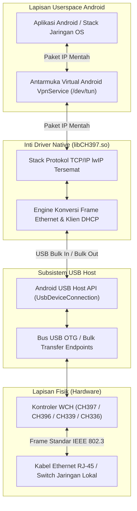
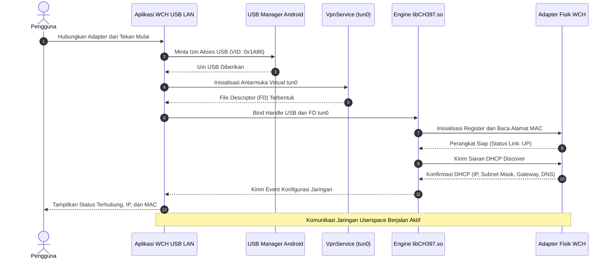

# WCH USB LAN

<p align="center">
  
</p>

<p align="center">
  <strong>Utilitas Manajemen dan Driver Android Tingkat Userspace untuk Kontroler WCH USB-to-Ethernet</strong>
</p>

[](LICENSE)
[-green.svg)](https://developer.android.com)
[](source/app/jniLibs)
[](https://github.com/anggixz)

---

> Bahasa: [English](README.md) | **Bahasa Indonesia**

---

## Daftar Isi

- [Gambaran Umum](#gambaran-umum)
- [Arsitektur Sistem](#arsitektur-sistem)
- [Siklus Koneksi](#siklus-koneksi)
- [Fitur Utama](#fitur-utama)
- [Perangkat Keras yang Didukung](#perangkat-keras-yang-didukung)
- [Panduan Pemasangan dan Penggunaan](#panduan-pemasangan-dan-penggunaan)
- [Kompilasi dari Kode Sumber](#kompilasi-dari-kode-sumber)
- [Struktur Direktori Proyek](#struktur-direktori-proyek)
- [Audit Keamanan dan Privasi](#audit-keamanan-dan-privasi)
- [Lisensi](#lisensi)
- [Pengembang dan Atribusi](#pengembang-dan-atribusi)

---

## Gambaran Umum

**WCH USB LAN** adalah utilitas driver Android sumber terbuka (*open-source*) yang dirancang untuk mengaktifkan konektivitas jaringan kabel Ethernet pada perangkat Android menggunakan adapter USB-ke-Ethernet berbasis chip WCH (Nanjing QinHeng Microelectronics) tanpa memerlukan **akses root**.

Banyak citra kernel Android bawaan pabrikan (seperti Xiaomi/MIUI/HyperOS, Samsung, Realme, OnePlus, dan Oppo) tidak menyertakan modul driver kernel (`ch397.ko` / `ch339.ko`) untuk kontroler WCH. Akibatnya, saat adapter WCH dicolokkan ke port USB OTG, sistem Android tidak dapat mendeteksi atau membuat antarmuka jaringan baru.

**WCH USB LAN** mengatasi keterbatasan tersebut sepenuhnya di tingkat *userspace* Android. Dengan menghubungkan **Android USB Host API** ke antarmuka jaringan virtual (**VpnService**) dan stack protokol TCP/IP ringan tersemat (**lwIP**), aplikasi ini menyediakan fungsionalitas jaringan kabel yang stabil tanpa perlu modifikasi kernel atau instalasi custom ROM.

---

## Arsitektur Sistem

Diagram berikut mengilustrasikan alur komunikasi paket data antara aplikasi Android dan kontroler Ethernet fisik:



### Rincian Arsitektur

1. **VpnService (`tun0`)**: Mencegat lalu lintas paket IP keluar dari aplikasi Android yang ditentukan dan meneruskan paket yang diterima kembali ke sistem operasi.
2. **Pustaka Native (`libCH397.so`)**: Mengintegrasikan stack protokol open-source **lwIP (Lightweight IP)**. Modul ini membungkus paket IP mentah menjadi frame Ethernet II, memantau status fisik sambungan kabel (*link state*), serta menangani negosiasi alamat IP otomatis (DHCP).
3. **Subsistem USB Host**: Memanfaatkan `android.hardware.usb.UsbManager` untuk mentransfer frame Ethernet bolak-balik melalui endpoint Bulk USB OTG perangkat keras.

---

## Siklus Koneksi



---

## Fitur Utama

- **Operasional Tanpa Root**: Beroperasi penuh tanpa hak akses *superuser*, custom recovery, maupun modifikasi kernel.
- **Deteksi Otomatis (Plug-and-Play)**: Penerima siaran sistem mendeteksi penyambungan dan pelepasan perangkat keras secara dinamis.
- **Stack Protokol Lengkap**: Implementasi lwIP native menangani protokol ARP, IPv4, UDP, TCP, ICMP, dan DHCP.
- **Kontrol Rute Per-Aplikasi**: Konfigurasi perutean fleksibel berbasis database Room SQLite lokal:
  - **Routing Global**: Seluruh lalu lintas data perangkat diarahkan melalui sambungan LAN.
  - **Routing Per-Aplikasi**: Hanya aplikasi yang dipilih oleh pengguna yang dialirkan ke kabel LAN, sementara aplikasi lain tetap menggunakan koneksi default (Wi-Fi atau Data Seluler).
- **Pengindeksan Aplikasi Cepat**: Algoritma pemindaian aplikasi yang dioptimalkan dengan penyaringan awal aplikasi sistem dan pengurutan alfabetis (A-Z).
- **Diagnostik Jaringan Real-Time**: Pemantauan komprehensif atas status layanan driver, status fisik kabel LAN, alamat MAC, IP Address, dan Subnet Mask.
- **Antarmuka Responsif & Modern**: Tata letak kartu bertema teknologi dengan kontras warna profesional, bebas pemotongan teks (*word-wrap overflow*) di berbagai dimensi layar.
- **Privasi Terjamin**: Beroperasi 100% luring (*offline*) tanpa analitik, tanpa telemetri, dan tanpa komunikasi server eksternal.

---

## Perangkat Keras yang Didukung

Mendukung lini kontroler USB-to-LAN dari WCH di bawah Vendor ID `0x1A86`:

| Model Kontroler | Spesifikasi USB | Standar Ethernet | Kecepatan Transfer |
| :--- | :--- | :--- | :--- |
| **CH397** | USB 2.0 High-Speed (480 Mbps) | IEEE 802.3 10/100Base-TX | 100 Mbps (Full Duplex) |
| **CH396** | USB 2.0 Full-Speed (12 Mbps) | IEEE 802.3 10/100Base-TX | 10/100 Mbps |
| **CH339** | USB 2.0 High-Speed (480 Mbps) | IEEE 802.3 10/100Base-TX | 100 Mbps (Full Duplex) |
| **CH336** | USB 2.0 Full-Speed (12 Mbps) | IEEE 802.3 10Base-T | 10 Mbps |

---

## Panduan Pemasangan dan Penggunaan

### Prasyarat
- Perangkat Android dengan versi Android 5.0 (API 21) hingga Android 14+ (API 34).
- Adapter USB OTG atau USB Type-C Hub yang mendukung USB Host.
- Adapter USB-to-LAN WCH yang didukung.

### Panduan Cepat

1. **Unduh Paket Aplikasi**:
   Unduh file APK rilis siap pakai terbaru (`app-release.apk`) dari halaman [GitHub Releases](https://github.com/anggixz/WCH-USBLAN-Android/releases), atau kompilasi langsung dari kode sumber.
2. **Pemasangan (Instalasi)**:
   - **Instalasi Normal**: Buka file `app-release.apk` langsung di perangkat Android Anda menggunakan File Manager atau menu unduhan browser, lalu tekan **Install** (izinkan instalasi dari sumber tidak dikenal jika diminta).
   - **Opsional (via ADB)**:
     ```bash
     adb install -r app-release.apk
     ```
3. **Penyambungan Perangkat**:
   - Tancapkan adapter WCH ke ponsel melalui konektor USB OTG.
   - Hubungkan kabel Ethernet RJ-45 yang terhubung ke switch, router, atau modem aktif.
4. **Pemberian Izin Sistem**:
   - Berikan konfirmasi izin akses perangkat USB saat dialog sistem muncul.
   - Setujui permintaan sambungan VPN (*VpnService prompt*) untuk mengizinkan pembuatan antarmuka `tun0`.
5. **Menjalankan Driver**:
   - Buka aplikasi **WCH USB LAN**, lalu tekan tombol **MULAI**.
   - Pastikan indikator status berubah menjadi **AKTIF** dan status kabel menampilkan **Terhubung**.

---

## Kompilasi dari Kode Sumber

### Kebutuhan Lingkungan Build
- **JDK**: Java Development Kit versi 17 atau 21
- **Android SDK**: Build-Tools 34.0.0, Compile SDK 34
- **Dukungan ABI NDK**: `arm64-v8a`, `armeabi-v7a`, `x86`, `x86_64`

### Prosedur Build

```bash
# 1. Kloning repositori
git clone https://github.com/anggixz/WCH-USBLAN-Android.git
cd WCH-USBLAN-Android/source

# 2. Konfigurasi path SDK pada file local.properties (jika belum ada)
echo "sdk.dir=/path/to/android-sdk" > local.properties

# 3. Eksekusi kompilasi rilis (Release)
./gradlew assembleRelease

# Lokasi output APK:
# app/build/outputs/apk/release/app-release.apk
```

---

## Struktur Direktori Proyek

```
WCH-USBLAN-Android/
├── docs/
│   └── assets/
│       └── logo.png                      # Aset logo dan branding proyek
│   └── WCHUSBNIC_Driver_Manual.pdf       # Dokumen panduan teknis resmi WCH
├── source/
│   ├── app/
│       │   ├── src/main/java/com/anggixz/wchusblan/
│       │   │   ├── MainActivity.java      # Kontrol utama driver dan visualisasi status
│       │   │   ├── APPBlockActivity.java  # Manajemen perutean jaringan per-aplikasi
│       │   │   ├── ui/                    # Komponen dialog responsif kustom
│       │   │   ├── database/              # Persistensi data lokal Room SQLite
│       │   │   └── util/                  # Utilitas pemindaian aplikasi yang dioptimalkan
│       │   ├── src/main/res/              # Aset ikon adaptif, layout, dan vector drawable
│       │   ├── libs/
│       │   │   └── WCHUSBNIC.jar          # Pustaka komunikasi protokol USB WCH
│       │   └── jniLibs/                   # Pustaka biner native C/C++ lwIP
│       │       ├── arm64-v8a/libCH397.so
│       │       ├── armeabi-v7a/libCH397.so
│       │       ├── x86/libCH397.so
│       │       └── x86_64/libCH397.so
│       └── ui/                            # Modul pustaka komponen UI pendukung
├── LICENSE                                # Berkas lisensi GNU AGPL v3.0
├── README.md                              # Dokumentasi teknis Bahasa Inggris
└── README.id.md                           # Dokumentasi teknis Bahasa Indonesia
```

---

## Audit Keamanan dan Privasi

Audit komprehensif terhadap seluruh kode sumber dan pustaka biner telah dilakukan:
- **Bebas Telemetri / Analitik**: Tidak menggunakan SDK analitik pihak ketiga, pustaka pelacak, atau layanan pemantauan latar belakang.
- **Bebas Endpoint Eksternal**: Tidak terdapat hardcoded URL, alamat IP server eksternal, atau C2 server pada kode sumber maupun pustaka native.
- **Penyimpanan Lokal Mandiri**: Seluruh konfigurasi perutean aplikasi tersimpan murni di database internal SQLite perangkat lokal tanpa sinkronisasi cloud.

---

## Lisensi

Proyek ini dilisensikan di bawah ketentuan **GNU Affero General Public License v3.0 (AGPL-3.0)**.  
Lihat berkas [LICENSE](LICENSE) untuk teks lisensi selengkapnya.

```
WCH USB LAN - Userspace Android Driver for WCH USB-to-Ethernet Controllers
Copyright (C) 2026 Anggixz <https://github.com/anggixz>

This program is free software: you can redistribute it and/or modify
it under the terms of the GNU Affero General Public License as published by
the Free Software Foundation, either version 3 of the License, or
(at your option) any later version.
```

---

## Pengembang dan Atribusi

- **Pengembang & Refactoring**: [Anggixz](https://github.com/anggixz)
- **Protokol Dasar Perangkat Keras**: Nanjing QinHeng Microelectronics Co., Ltd. (WCH)
- **Stack Jaringan TCP/IP**: lwIP (Lightweight IP) Project
