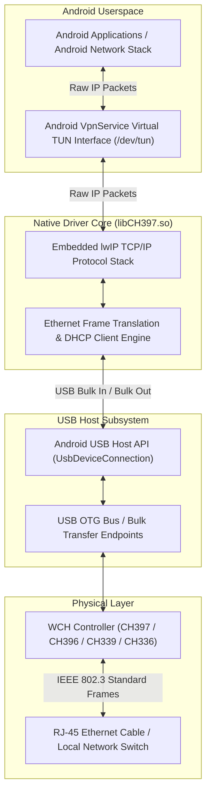
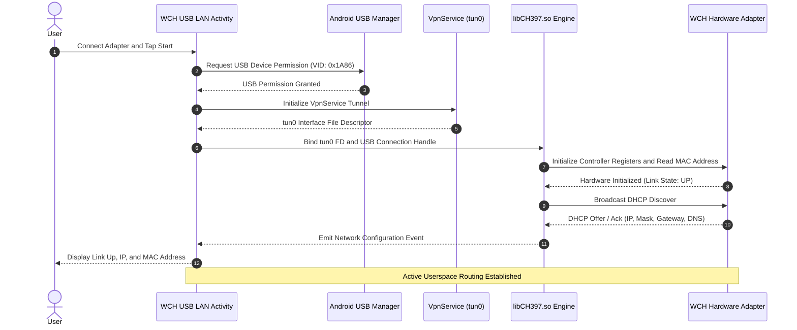

# WCH USB LAN

<p align="center">
  
</p>

<p align="center">
  <strong>Userspace Android Driver and Management Utility for WCH USB-to-Ethernet Controllers</strong>
</p>

[](LICENSE)
[-green.svg)](https://developer.android.com)
[](source/app/jniLibs)
[](https://github.com/anggixz)

---

> Language: **English** | [Bahasa Indonesia](README.id.md)

---

## Table of Contents

- [Overview](#overview)
- [System Architecture](#system-architecture)
- [Connection Lifecycle](#connection-lifecycle)
- [Key Features](#key-features)
- [Supported Hardware](#supported-hardware)
- [Installation and Usage](#installation-and-usage)
- [Building from Source](#building-from-source)
- [Project Directory Structure](#project-directory-structure)
- [Security and Privacy Audit](#security-and-privacy-audit)
- [License](#license)
- [Author and Acknowledgements](#author-and-acknowledgements)

---

## Overview

**WCH USB LAN** is an open-source Android driver utility that enables wired Ethernet connectivity on Android devices using WCH (Nanjing QinHeng Microelectronics) USB-to-Ethernet controllers without requiring **root privileges**.

Stock Android kernel images on many vendor devices (such as Xiaomi/MIUI/HyperOS, Samsung, Realme, OnePlus, and Oppo) omit kernel modules (`ch397.ko` / `ch339.ko`) for WCH Ethernet chips. As a result, plugging in a standard WCH adapter yields no network interface.

**WCH USB LAN** resolves this limitation entirely in Android userspace. By bridging the **Android USB Host API** with a virtual network tunnel (**VpnService**) and an embedded lightweight TCP/IP stack (**lwIP**), the application delivers high-performance, system-wide or per-application wired networking without modifying the system kernel or flashing custom software.

---

## System Architecture

The following diagram illustrates the flow of network packets between Android user applications and the physical Ethernet controller:



### Architecture Breakdown

1. **VpnService (`tun0`)**: Intercepts outbound IP traffic from selected (or all) Android applications and receives inbound packets forwarded back to the OS.
2. **Native Shared Library (`libCH397.so`)**: Integrates the standard open-source **lwIP (Lightweight IP)** protocol stack. It encapsulates raw IP packets into standard Ethernet II frames, manages link states, and handles dynamic IP negotiation (DHCP).
3. **USB Host Subsystem**: Uses Android's `android.hardware.usb.UsbManager` to transfer Ethernet frames to and from the adapter's physical bulk endpoints (IN/OUT) over USB OTG.

---

## Connection Lifecycle



---

## Key Features

- **Rootless Operation**: Fully functional without root access, custom recovery, or kernel modification.
- **Plug-and-Play Detection**: Broadcast receivers detect adapter insertion and removal dynamically.
- **Integrated TCP/IP Stack**: Native lwIP implementation handles ARP, IPv4, UDP, TCP, ICMP, and DHCP protocol processing.
- **Per-Application Routing Control**: Granular whitelist/blacklist routing configured via local Room SQLite database:
  - **Global Routing**: Routes all device traffic through the USB LAN interface.
  - **Per-App Routing**: Routes only user-selected applications through USB LAN, leaving other apps on default interfaces (Wi-Fi or Cellular).
- **Fast Application Indexing**: Optimized package retrieval algorithms with early system-app filtering and alphabetical sorting.
- **Real-Time Link Diagnostics**: Comprehensive monitoring of driver service state, physical cable link status, MAC address, assigned IP, and subnet mask.
- **Modern Responsive Interface**: Technical blue and slate interface conforming to modern Android layout practices, supporting varied screen dimensions without text truncation.
- **Privacy and Isolation**: 100% offline operation with zero third-party telemetry, analytics, or external server calls.

---

## Supported Hardware

The driver supports WCH USB-to-LAN controllers under Vendor ID `0x1A86`:

| Controller Model | USB Specification | Ethernet Standard | Transfer Speed |
| :--- | :--- | :--- | :--- |
| **CH397** | USB 2.0 High-Speed (480 Mbps) | IEEE 802.3 10/100Base-TX | 100 Mbps (Full Duplex) |
| **CH396** | USB 2.0 Full-Speed (12 Mbps) | IEEE 802.3 10/100Base-TX | 10/100 Mbps |
| **CH339** | USB 2.0 High-Speed (480 Mbps) | IEEE 802.3 10/100Base-TX | 100 Mbps (Full Duplex) |
| **CH336** | USB 2.0 Full-Speed (12 Mbps) | IEEE 802.3 10Base-T | 10 Mbps |

---

## Installation and Usage

### Prerequisites
- Android device running Android 5.0 (API 21) through Android 14+ (API 34).
- USB On-The-Go (OTG) adapter or Type-C hub.
- Supported WCH USB-to-LAN adapter.

### Quick Start

1. **Obtain APK**:
   Download the latest precompiled release APK (`app-release.apk`) from the [GitHub Releases](https://github.com/anggixz/WCH-USBLAN-Android/releases) page, or build it directly from source.
2. **Installation**:
   - **Standard Installation**: Open the downloaded `app-release.apk` directly on your Android device using any File Manager or browser download manager, then tap **Install** (enable "Install unknown apps" if prompted).
   - **Optional (via ADB)**:
     ```bash
     adb install -r app-release.apk
     ```
3. **Connect Hardware**:
   - Plug the WCH adapter into your Android device via USB OTG.
   - Connect an active RJ-45 cable connected to a network switch or router.
4. **Grant Permissions**:
   - Confirm the USB device access prompt when prompted by Android.
   - Accept the Android VPN Connection request to allow `tun0` interface routing.
5. **Start Driver**:
   - Tap **MULAI** (Start).
   - Verify that the driver status displays **AKTIF** and physical link status displays **Terhubung** (Connected).

---

## Building from Source

### Build Requirements
- **JDK**: Java Development Kit 17 or 21
- **Android SDK**: Build-Tools 34.0.0, Compile SDK 34
- **NDK ABI Support**: `arm64-v8a`, `armeabi-v7a`, `x86`, `x86_64`

### Build Procedure

```bash
# 1. Clone repository
git clone https://github.com/anggixz/WCH-USBLAN-Android.git
cd WCH-USBLAN-Android/source

# 2. Configure SDK location in local.properties (if not already set)
echo "sdk.dir=/path/to/android-sdk" > local.properties

# 3. Compile release build
./gradlew assembleRelease

# Output APK:
# app/build/outputs/apk/release/app-release.apk
```

---

## Project Directory Structure

```
WCH-USBLAN-Android/
├── docs/
│   ├── assets/
│   │   └── logo.png                      # Project branding and logo asset
│   └── WCHUSBNIC_Driver_Manual.pdf       # Official WCH driver documentation
├── source/
│   ├── app/
│       │   ├── src/main/java/com/anggixz/wchusblan/
│       │   │   ├── MainActivity.java      # Primary driver control and link state UI
│       │   │   ├── APPBlockActivity.java  # Per-application network routing management
│       │   │   ├── ui/                    # Custom responsive dialog components
│       │   │   ├── database/              # Room SQLite database persistence
│       │   │   └── util/                  # Optimized package query utilities
│       │   ├── src/main/res/              # Adaptive icons, layouts, and vector drawables
│       │   ├── libs/
│       │   │   └── WCHUSBNIC.jar          # WCH USB communication interface library
│       │   └── jniLibs/                   # Native binaries containing embedded lwIP
│       │       ├── arm64-v8a/libCH397.so
│       │       ├── armeabi-v7a/libCH397.so
│       │       ├── x86/libCH397.so
│       │       └── x86_64/libCH397.so
│       └── ui/                            # Reusable UI component library module
├── LICENSE                                # GNU AGPL v3.0 License
├── README.md                              # English Documentation
└── README.id.md                           # Indonesian Documentation
```

---

## Security and Privacy Audit

A comprehensive code and binary audit was performed on this repository:
- **No Telemetry / Analytics**: Zero analytical SDKs, remote tracking libraries, or background monitoring services.
- **No Hardcoded Endpoints**: No unauthorized external URLs, IP addresses, or command-and-control servers in either source code or compiled native binaries.
- **Local Persistence**: User network routing configurations are stored exclusively in an internal, non-exported SQLite database on the local device.

---

## License

This project is licensed under the **GNU Affero General Public License v3.0 (AGPL-3.0)**.  
See the [LICENSE](LICENSE) file for the full license terms.

```
WCH USB LAN - Userspace Android Driver for WCH USB-to-Ethernet Controllers
Copyright (C) 2026 Anggixz <https://github.com/anggixz>

This program is free software: you can redistribute it and/or modify
it under the terms of the GNU Affero General Public License as published by
the Free Software Foundation, either version 3 of the License, or
(at your option) any later version.
```

---

## Author and Acknowledgements

- **Development & Refactoring**: [Anggixz](https://github.com/anggixz)
- **Base Hardware Driver Protocol**: Nanjing QinHeng Microelectronics Co., Ltd. (WCH)
- **Networking Stack**: lwIP (Lightweight IP) Project
